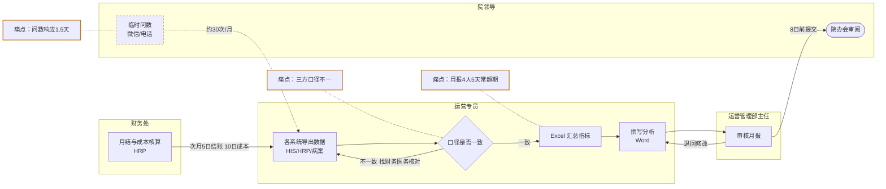
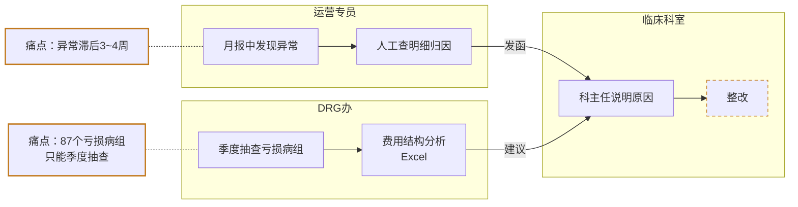

# 业务流转图

## 一、文件头

- 项目：云州一院运营决策智能体（示例）
- 版本：v1.0
- 日期：2026-05-28
- 编写人：FDE 项目经理（模拟示例数据）
- 资料来源：knowledge/02-需求说明-运营管理部.md、knowledge/03-访谈记录-财务处与医务处.md、knowledge/04-运营月报样例-2026年4月.csv

## 二、场景 P1：月度运营分析报告

## 三、场景 P2：指标异常预警与 DRG 病组运营

| 编号 | 节点/环节 | 执行角色 | 输入 | 处理动作 | 输出 | 涉及系统 | 可信度 | 异常/例外 | AI 嵌入 |
| --- | --- | --- | --- | --- | --- | --- | --- | --- | --- |
| P1-01 | 各系统导出数据 | 运营专员 | 系统报表 | 手工导出 | 原始 Excel | HIS、HRP/HR 系统、线下文件 | 资料 | 系统未结账需等待 | 阶段二 |
| P1-02 | 口径核对 | 运营专员 | 原始 Excel | 与财务、医务核对 | 一致数据 | 线下文件 | 资料 | 口径分歧需开会 | 阶段二 |
| P1-03 | Excel 汇总指标 | 运营专员 | 一致数据 | 计算 9 项核心指标 | 指标表 | 线下文件 | 资料 | 公式出错 | 阶段二 |
| P1-04 | 撰写分析 | 运营专员 | 指标表 | 写同比环比与原因 | 月报草稿 | 线下文件 | 资料 | 原因说不清 | 阶段二 |
| P1-05 | 月结与成本核算 | 财务处 | 收费、成本 | 结账、分摊 | 收入成本表 | HRP/HR 系统 | 资料 | 延迟结账 | 阶段二 |
| P1-06 | 审核月报 | 运营管理部主任 | 月报草稿 | 审核 | 月报终稿 | 线下文件 | 资料 | 退回 | 阶段二 |
| P1-08 | 临时问数 | 院领导 | 问题 | 微信/电话提出 | 取数需求 | 无 | 推测 | 无记录 | 阶段二 |
| P2-01 | 发现异常 | 运营专员 | 月报 | 人工比对 | 异常清单 | 线下文件 | 资料 | 遗漏 | 阶段二 |
| P2-02 | 人工归因 | 运营专员 | 异常清单 | 查明细 | 归因说明 | HIS | 资料 | 无法归因 | 阶段二 |
| P2-05 | 季度抽查亏损病组 | DRG 办 | 入组明细 | 抽查 | 亏损清单 | 线下文件 | 资料 | 覆盖不全 | 阶段二 |

## 四、痛点汇总

| 痛点 | 关联节点 | 影响 | 可信度 | 依据 |
| --- | --- | --- | --- | --- |
| 月报 4 人 5 个工作日，常超期 | P1-01~P1-04 | 运营部人力占用 | 资料 | 02-需求说明 |
| 三方口径不一，院办会两套数 | P1-02 | 决策可信度 | 资料 | 02、03 |
| 异常发现滞后 3~4 周 | P2-01 | 错过干预窗口 | 资料 | 02-需求说明 |
| 87 个亏损病组只能季度抽查 | P2-05 | DRG 亏损持续 | 资料 | 01、03 |
| 临时问数平均响应 1.5 个工作日 | P1-08 | 院领导决策等待 | 资料 | 02-需求说明 |

## 五、待确认事项

| 编号 | 问题 | 关联节点 | 应向谁确认 |
| --- | --- | --- | --- |
| Q-01 | 院级统一口径表何时由院长办公会审定 | P1-02 | 运营管理部 |
| Q-06 | 科室整改是否有跟踪机制 | P2-04 | 医务处 |
