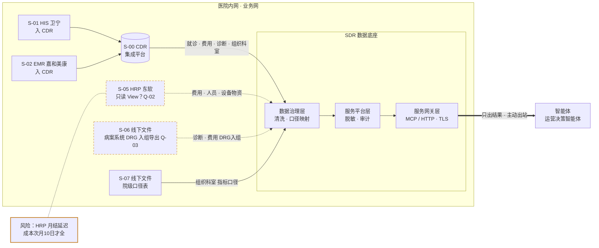

# 数据流程图

## 一、文件头

- 项目：云州一院运营决策智能体（示例）
- 版本：v1.0
- 日期：2026-05-28
- 编写人：FDE 项目经理（模拟示例数据）
- 资料来源：knowledge/01-医院概况.md、knowledge/03-访谈记录-财务处与医务处.md

## 二、CDR 判断

已有（资料：knowledge/01-医院概况.md）。CDR 覆盖 HIS/EMR/LIS/PACS，HRP 与病案系统未接入；本图按"CDR + 两个系统单独对接"绘制。CDR 是否含费用明细与床位日报待确认（Q-04）。

## 三、数据流程图

## 四、系统清单

| 编号 | 系统（标准名） | 厂商 | 主要数据域 | 接入方式 | 可信度 | 风险 | 应向谁确认 |
| --- | --- | --- | --- | --- | --- | --- | --- |
| S-00 | CDR | 集成平台 | 就诊、诊断、医嘱、费用、组织科室 | 只读 View | 资料 | 费用明细覆盖待确认 | 信息中心 钱永安 |
| S-01 | HIS | 卫宁健康 | 就诊、费用、组织科室 | 经 CDR | 资料 | 无 | 信息中心 |
| S-02 | EMR | 嘉和美康 | 诊断 | 经 CDR | 资料 | 无 | 信息中心 |
| S-05 | HRP/HR 系统 | 东软 | 费用、人员、设备物资 | 待确认 | 待确认 | 月结延迟 | 财务处、信息中心 |
| S-06 | 线下文件 | 病案系统导出 | 诊断、费用 | 文件导入 | 推测 | 字段待确认 | DRG 办 |
| S-07 | 线下文件 | 运营管理部 | 组织科室 | 文件导入 | 资料 | 待审定 | 运营管理部 |

## 五、接入风险

| 风险 | 关联系统 | 影响 | 应对建议 |
| --- | --- | --- | --- |
| HRP 月结次月 5 日、成本次月 10 日 | S-05 | 月报初稿最早次月 10 日 | 收入类指标先出，成本类次月 10 日补 |
| 病案系统未接入 CDR | S-06 | DRG 分析依赖导出 | 首期按月文件导入 |
| 口径表未审定 | S-07 | 指标两套数 | 首期以运营部草案为准并标版本 |

## 六、待确认事项

| 编号 | 问题 | 关联系统 | 应向谁确认 |
| --- | --- | --- | --- |
| Q-02 | HRP 收入成本能否提供只读视图 | S-05 | 信息中心、财务处 |
| Q-03 | DRG 入组明细导出字段 | S-06 | DRG 办 |
| Q-04 | CDR 是否含费用明细与床位日报 | S-00 | 信息中心 |
